  

# 🌐 Awesome AI Web Scraping & Extraction 🚀

  
  
  
  
  
  

## ⚡ Curated Directory of Next-Gen AI Web Scraping, LLM Data Extraction & Web Crawling

**A comprehensive, production-tested index of enterprise SaaS platforms and high-performance open-source libraries.**  
*Engineered for AI/ML teams, LLM fine-tuning, RAG data ingestion pipelines, autonomous web agent navigation, anti-bot circumvention, and intelligent web parsing.*

**Last updated: October 2026** 📅

---

### 🔍 Quick Overview & Ecosystem Focus

The modern data extraction landscape has shifted from fragile XPath and CSS selector parsing to **AI-native web data extraction** and **autonomous agentic crawling**. Whether converting massive multi-page web structures into LLM-digestible clean Markdown for RAG architectures, querying structured JSON directly from websites using vision-language models, or circumventing modern anti-bot architectures (Cloudflare, Akamai, PerimeterX) at scale, choosing the appropriate infrastructure is mission-critical.

This repository tracks:
- 🏢 **Enterprise SaaS & Managed Scraping Infrastructure**: Turnkey extraction APIs, residential proxy rotation networks, automated CAPTCHA resolution, and scalable cloud scrapers.
- 💻 **Open-Source GitHub Frameworks**: Self-hosted web crawlers, browser automation engines (CDP / WebDriver), AI web agents, and token-efficient HTML-to-Markdown converters.

Contributions welcome! Submit a Pull Request with new libraries, benchmarks, and updates. 🤝

---

## 📑 Table of Contents
- [📊 Sector Overview & Market Dynamics](#-sector-overview--market-dynamics)
- [🏢 SaaS & Hosted Platforms](#-saas--hosted-platforms)
- [💻 Open-Source GitHub Projects](#-open-source-github-projects)
- [🛠️ Best Practices for Hybrid Architecture](#️-best-practices-for-hybrid-architecture)
- [🤝 How to Contribute](#-how-to-contribute)
- [💖 Support & Sponsorship](#-support--sponsorship)
- [⚠️ Disclaimer & Compliance](#️-disclaimer--compliance)
- [📈 Star History](#-star-history)

---

## 📊 Sector Overview & Market Dynamics

The global web data extraction, web crawling, and proxy infrastructure market is estimated at **$1.5 billion to $2.2 billion** and is expanding rapidly (20%+ CAGR) propelled by soaring data ingestion requirements from generative AI, LLM pre-training corpora, and autonomous agents. The sector exhibits **moderate concentration with a barbell distribution**: market leaders (such as Oxylabs and Bright Data) dominate high-volume enterprise proxy pipelines, while a highly dynamic and fragmented ecosystem of specialized AI-first startups (Firecrawl, Apify Actors, Browser-Use) rapidly captures modern LLM and RAG data pipeline workflows.

---

## 🏢 SaaS & Hosted Platforms

| Product | Company Size / Valuation | Starting Pricing | Free Tier / Trial Limits | Key Features & Focus |
| :--- | :--- | :--- | :--- | :--- |
| **[Oxylabs](https://oxylabs.io/)** 🛡️ | **$3.6B Valuation** (~$350M ARR) | **$49/mo** (Micro plan, ~98k results) | **Free trial**: 2,000 results (no credit card required) | Enterprise proxy network & Web Scraper API with Realtime, Push-Pull, and Proxy endpoints; includes OxyCopilot AI assistant. |
| **[Bright Data](https://brightdata.com/)** ⚡ | **>$1.0B Valuation** (~$300M+ ARR) | **$0.75 / 1,000 records** (pay-as-you-go) | **Free tier**: 5,000 credits/records per month (renews monthly, no credit card required) | 400M+ IPs, 1,000+ pre-built scrapers, AI Scraper Studio with automated self-healing scrapers, and MCP server support. |
| **[Diffbot](https://www.diffbot.com/)** 🧠 | **>$100M Valuation** (~$3M–$5M ARR) | **$299/mo** (Startup plan, 250,000 credits) | **Free tier**: 10,000 credits per month | Computer vision and NLP extraction without manual rules; Extract API for articles, products, and discussions; Knowledge Graph. |
| **[Import.io](https://www.import.io/)** 🎯 | **$50M–$100M Valuation** (Acquired by Neuralogics) | **$199/mo** (Standard plan, 50,000 queries/mo) | **Free trial**: 30 days & 5,000 queries (no credit card required) | AI-native pricing intelligence platform and Aperture engine with automated extraction, validation, and adaptive monitoring. |
| **[Zyte](https://www.zyte.com/)** *(Scrapinghub)* 🕷️ | **$25M ARR** (Privately held, creator of Scrapy) | **$0.13 / 1,000 requests** (HTTP) / **$500/mo** (Managed standard) | **Free trial**: 30 days & $5 free usage credit | Managed data extraction by the creators of Scrapy, Zyte API with anti-bot bypass, automated data models, and Scrapy Cloud. |
| **[Apify](https://apify.com/)** 🤖 | **$15M–$25M Valuation** (~$7.5M–$14M ARR) | **$19/mo** (Starter plan with $19 prepaid usage) | **Free tier**: $5 prepaid platform usage credit per month (up to 16 GB Actor RAM, resets monthly) | Serverless cloud platform with 6,000+ ready-to-use Actors, dataset storage, and Agent General Interface (AGI) via x402/MPP. |
| **[Octoparse](https://www.octoparse.com/)** 🖱️ | **~$5.7M ARR** (Privately held) | **$83/mo** (Standard plan billed annually) | **Free tier**: Free forever (up to 10 tasks, unlimited pages locally, 10,000 rows/export, 50,000 rows/mo) | Visual no-code desktop scraper with Auto-Detect workflow builder, local crawling, and export to CSV/Excel/JSON. |
| **[Crawlbase](https://crawlbase.com/)** 🔌 | **~$2.9M ARR** (Bootstrapped) | **$3.00 / 1,000 requests** (Pay-as-you-go) | **Free trial**: 1,000 free requests on signup (scales to 5,000 upon onboarding, no credit card required) | All-in-one Crawling & Scraper API, JavaScript rendering support, Leads API, Screenshots API, and Python SDK. |
| **[ParseHub](https://www.parsehub.com/)** 👁️ | **~$1M–$2.6M ARR** (Bootstrapped) | **$189/mo** (Standard plan, 20 private projects) | **Free tier**: Free forever (up to 5 public projects, 200 pages per run, 14-day data retention) | Visual desktop web scraper with click-to-select point-and-click UI, client-side IP rotation, and REST API. |

---

## 💻 Open-Source GitHub Projects

Sorted in descending order by GitHub stars ⭐. Each tool includes direct repository metrics, primary architecture, and strategic use cases.

- **[Firecrawl](https://github.com/mendableai/firecrawl)**  🔥  
  **The leading open-source web data interface converting full websites into LLM-ready markdown** (AGPL-3.0). **The most widely adopted tool for AI/RAG data pipelines**—powers the Firecrawl API service and is fully self-hostable. Features **crawl, scrape, map, and search** endpoints with automated sub-page discovery.

- **[Browser-Use](https://github.com/browser-use/browser-use)**  🌐  
  **Autonomous web scraping and agent navigation framework** (MIT). Enables AI agents to interact with any website using multi-modal LLMs (GPT-4o, Claude 3.5 Sonnet), clicking buttons, entering data, navigating pagination, and extracting complex nested structures.

- **[Playwright](https://github.com/microsoft/playwright)**  🎭  
  **Modern headless browser automation and web testing framework** (Apache-2.0). **Native JavaScript rendering** with built-in auto-waiting, network interception, and execution across Chromium, Firefox, and WebKit in Python, Node.js, Java, and .NET.

- **[Puppeteer](https://github.com/puppeteer/puppeteer)**  🎪  
  **Direct Chrome & Chromium automation via the Chrome DevTools Protocol (CDP)** (Apache-2.0). Provides fine-grained control over headless browser instances, PDF generation, screenshot capture, and single-page app (SPA) DOM hydration.

- **[Crawl4AI](https://github.com/unclecode/crawl4ai)**  🚀  
  **Open-source LLM-friendly web crawler and data extractor** (Apache-2.0 with attribution clause). **Purpose-built for AI/RAG ingestion pipelines**—delivers blazing-fast speed, adaptive crawling, heuristics-based chunking, CSS selector extraction, and clean Markdown generation.

- **[Scrapy](https://github.com/scrapy/scrapy)**  🕷️  
  **The battle-tested standard for large-scale structured web crawls in Python** (BSD-3-Clause). High-throughput asynchronous crawling engine with built-in pipelines, extensible middleware, spider management, and native integration with `scrapy-playwright`.

- **[Changedetection.io](https://github.com/dgtlmoon/changedetection.io)**  🔔  
  **Self-hosted change monitoring and web scraping alert engine** (Apache-2.0). Tracks web page modifications, price drops, restocks, and content updates with visual diffing, JSON filtering, and automated webhook dispatch.

- **[Selenium](https://github.com/SeleniumHQ/selenium)**  🧭  
  **The foundational cross-browser automation suite** (Apache-2.0). Widest browser and language compatibility matrix available—powering cross-platform WebDriver integration across Python, Java, C#, Ruby, and JavaScript.

- **[ScrapeGraphAI](https://github.com/ScrapeGraphAI/Scrapegraph-ai)**  🧠  
  **Python scraper using LLM graph pipelines to automate extraction** (MIT). Describe what information you need in natural language, and the LLM builds and executes multi-step graph pipelines without manual CSS or XPath selectors.

- **[Crawlee](https://github.com/apify/crawlee)**  📦  
  **Production-grade web scraping and browser automation library for Node.js and Python** (Apache-2.0). Built-in request queues, automatic proxy management, session pools, fingerprint rotation, and headless browser orchestration.

- **[AutoScraper](https://github.com/alirezamika/autoscraper)**  🔮  
  **Smart, lightweight, and automatic Python web scraper** (MIT). Automatically learns extraction rules and patterns given sample target values or URLs, minimizing manual selector authoring.

- **[Puppeteer-Extra](https://github.com/berstend/puppeteer-extra)**  🥷  
  **Modular plugin framework for Puppeteer and Playwright** (MIT). Home of `puppeteer-extra-plugin-stealth`—the industry-standard stealth engine to avoid headless browser detection and anti-bot challenges.

- **[Apache Nutch](https://github.com/apache/nutch)**  🐘  
  **Highly extensible, enterprise-grade distributed web crawler** (Apache-2.0). Built on top of Apache Hadoop data structures for planet-scale web indexing and enterprise search engines.

- **[Grab](https://github.com/lorien/grab)**  🏎️  
  **High-performance Python web scraping and crawling framework** (MIT). Features a customizable network core, Spider multi-threaded crawling framework, and built-in proxy pool handling.

- **[Web Scraper Extension](https://github.com/webs/scraper)**  🧩  
  **Point-and-click browser extension for extracting data directly within Chrome** (Open-Core). Allows non-technical operators to build sitemaps, handle pagination, and export clean CSV datasets locally.

- **[BeautifulSoup](https://www.crummy.com/software/BeautifulSoup/)** 🍲  
  **The Python library for pulling data out of HTML and XML files** (MIT). Blazingly fast for static DOM structures with simple navigability when combined with `requests` or `httpx`.

---

### 🛠️ Best Practices for Hybrid Architecture

Building resilient, cost-efficient data infrastructure usually requires a **hybrid tiering approach**:
1. **Tier 1 (Static/Fast Ingestion)**: Use lightweight parsers (`BeautifulSoup`, `httpx`, `Scrapy`) for lightweight HTML payloads and static documentation.
2. **Tier 2 (Dynamic/JS SPAs & Markdown Generation)**: Utilize `Firecrawl` or `Crawl4AI` paired with `Playwright` or `Crawlee` to extract clean, token-efficient Markdown for LLM ingestion.
3. **Tier 3 (Anti-Bot & Protected Endpoints)**: Offload high-defense domains to enterprise managed APIs (`Bright Data`, `Oxylabs`, `Zyte`) to leverage continuous proxy rotation, fingerprint spoofing, and automatic CAPTCHA solving.

---

## 🤝 How to Contribute

1. Fork this repository 🍴
2. Create your feature branch (`git checkout -b feature/new-scraping-tool`)
3. Add your proposed tool or framework following the established tabular and list formats 📝
4. Ensure all descriptions are concise, factual, and backed by documentation 🔍
5. Commit and push your changes, then open a Pull Request! 🚀

---

## 💖 Support & Sponsorship

If you find this curated collection valuable for your AI projects, web data pipelines, or engineering research, please consider supporting the project:

- ⭐ **Star this repository** on GitHub to help others discover it!
- 🍴 **Fork and share** with colleagues and data teams.
- ☕ **Buy me a coffee / Sponsor**: If you'd like to support ongoing maintenance and new ecosystem benchmarks, visit my **[GitHub Sponsor Dashboard](https://github.com/sponsors/ishandutta2007)**! Thank you so much for your support! 🙌

---

## ⚠️ Disclaimer & Compliance

- This repository is a community-maintained index for informational and educational purposes.
- Always review and adhere to **robots.txt**, target platform **Terms of Service**, copyright protections, and international privacy regulations (**GDPR, CCPA**). Obtain necessary authorization before scraping private or copyrighted data.
- **Hidden Cost of Self-Hosting**: Running high-scale headless browsers requires compute, proxy bandwidth ($5+/GB for residential pools), and ongoing engineering maintenance against anti-bot shifts. Evaluate whether managed APIs or self-hosted clusters offer the lowest total cost of ownership (TCO).

---

##  Strr History

---

  Maintained by <a href="https://github.com/ishandutta2007">Ishan Dutta</a> • Built for the Global AI &amp; Data Engineering Community 🌍

